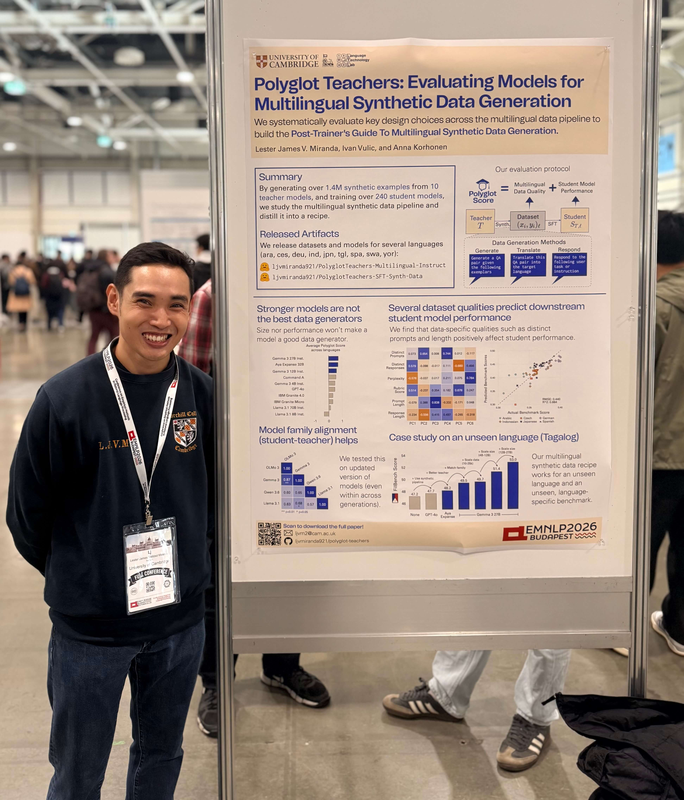
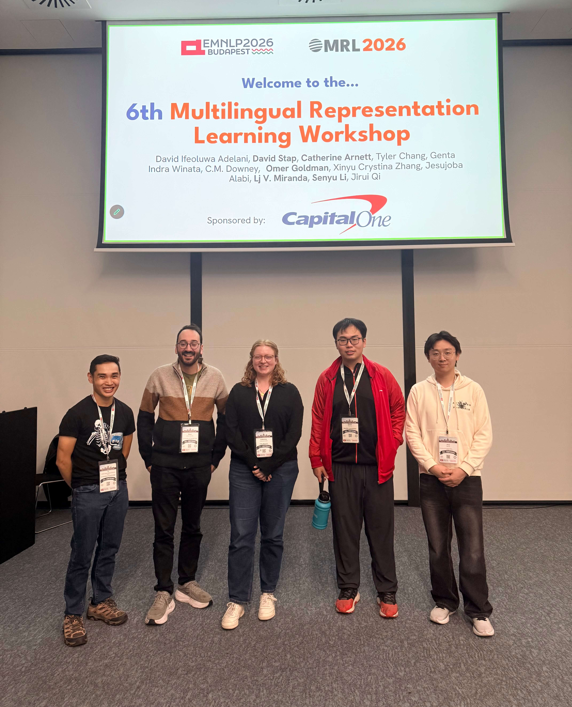

The [EMNLP 2026 Conference](https://2026.emnlp.org/) in Budapest has been such a blast!
This is one of the top NLP conferences in the field and I feel honored to have presented my work there.
It's also a conference of firsts as I presented my first PhD paper and my first time co-organizing a workshop!
Finally, Budapest as a city is beautiful---it was a nice experience :) 

## My conference activities

### Presenting my research on multilingual synthetic data generation

I presented my first PhD paper, [Polyglot Teachers: Evaluating Language Models for Multilingual Synthetic Data Generation](https://aclanthology.org/2026.emnlp-main.440/), where we performed a comprehensive analysis of synthetic data generation techniques for producing high-quality multilingual data.
We also introduced a metric, called Polyglot Score, that takes into consideration both the intrinsic and extrinsic qualities of the generated data and the model it has been trained on.

{: style="float: left; width: 40%; margin: 0.3em 1.5em 0.5em 0; border: 1px solid black; box-shadow: 4px 4px 8px rgba(0, 0, 0, 0.25);"}

Synthetic data has been on my mind since my pre-doc days.
In some ways, I've been influenced by my prior work on T&uuml;lu 3 and by one of my mentors, Yizhong, who created [self-instruct](https://aclanthology.org/2023.acl-long.754/).
When applying for PhD programs, one thing that was on my mind was how we can optimize the synthetic data pipeline to improve multilingual capabilities.
I am happy to have been given the opportunity to explore this problem during my PhD, and to have been provided with the compute to do so! Thank you, Isambard and Cambridge CSD3!

*Future outlook:* I think synthetic data for post-training will continue to be relevant, albeit in different forms.
Nowadays, much of the field has moved on from off-policy distillation (i.e., generating text from a teacher and using that as a learning signal) and has focused on on-policy or RL-based approaches.
I've also seen several works taking synthetic data generation to the next level, such as Adaption's [Invent-A-Dataset](https://www.alphaxiv.org/abs/2609.invent-a-dataset-zero-seed) or Meta's [Autodata](https://www.alphaxiv.org/abs/2606.25996).
**I have some upcoming works that explore both directions**. One is [DataSmith](/datasmith/), which is a method for synthesizing multilingual instruction-tuning data with the help of external tools.
Stay tuned!

### Co-organizing the MRL 2026 workshop and Shared Task

This year, I also helped co-organize the [2026 Workshop on Multilingual Representation Learning and Shared Task](https://sigtyp.github.io/ws2026-mrl.html).
It was a nice experience, as I was able to see how workshop organization happens at this scale.
My primary responsibility was to handle social media communications, such as making posters, updating the website, and inviting keynote speakers.

{: style="float: left; width: 40%; margin: 0.3em 1.5em 0.5em 0; border: 1px solid black; box-shadow: 4px 4px 8px rgba(0, 0, 0, 0.25);"}

During the workshop, I helped out with several of the last-mile preparations and with live-tweeting the event.
This took me back to my undergrad student org days of managing events and making sure the program flows well.
I didn't realize that I still had *it* in me; it's nice to rediscover that I still have the same energy I had ten years ago!
I admit, though, that after the workshop I felt so exhausted that I didn't have the energy to go out.
All in all, I enjoyed doing this and will definitely be back again next year.

Aside from the workshop proper, I also helped out in this year's [Shared Task](https://mrlbenchmarks.github.io/).
This time, the goal was to create a challenging benchmark in the style of [ECLeKTic](https://arxiv.org/abs/2502.21228).
I helped out with setting up and managing the Discord server and with evaluating the submissions.
We had a really nice turnout!
I am so thankful to all the teams for the care and quality of their submissions.
The 2026 Shared Task is not yet over, and we're hoping to continue onward to the multimodal phase.

{% include figure.html
   src="/assets/images/field-report-emnlp26/poster_a.jpeg,/assets/images/field-report-emnlp26/poster_b.jpg,/assets/images/field-report-emnlp26/poster_c.jpeg"
   height="300"
   caption="Poster session during the MRL 2026 Workshop. The poster area for MRL is very lively! In the middle, you can see me with Senyu Li looking at the very creative poster by the [Pag-refuse](https://aclanthology.org/2026.mrl-1.41/) authors. Their poster overlays text in different colors, so you have to look through colored plastic filters to read each layer."
   class="framed" %}

## Miscellaneous 

- **My supervisor, Anna Korhonen, gave a [keynote talk](https://2026.emnlp.org/program/keynotes/#keynote-3-anna-korhonen)**

- **I joined the SEACrowd Birds-of-a-Feather (BoF)**

## Reflections

The conference left me with a lot to think about, so I want to note some of them down here.

- **Our love or hate relationship with AI agents.** One of the biggest conversations I overheard was about the growing use of AI in our daily workflows, and the trust (or mistrust) that comes with it.
I heard a lot of complaints about rampant Claude use in talks, posters, and oral presentations, not to mention the growing concern over "claudeslop" in paper submissions and reviews.
If I had to describe the general sentiment, it would be disgust&mdash;most people don't like Claude interfering with the research process.

  And yet, according to the [Program Chairs' opening remarks](https://underline.io/events/535/schedule/sessions/23310/lecture/169657-opening-session?tab=video), LLM agents was the most popular research topic this year.
  Walking through the poster sessions, you see a lot of papers on autoscientists or on using LLM agents in the research process.
  The irony is almost funny: we complain about AI in our research while making it the subject of our research.

- **For multilinguality, we know the problem but struggle with the solutions.**
  Another discussion that came up in both the SEACrowd BoF and the MRL workshop was how asymmetric the resources for developing LMs are.
  In the SEACrowd BoF, we talked a lot about sovereignty.
  Sovereignty in this case means having the capacity to build our own models, with less reliance on foreign model providers outside our control.

  Everyone believes that sovereignty is important, but getting there requires a lot of data and compute, both of which are hard to come by.
  At MRL, Prof. Aji's talk on evaluation highlighted the lack of truly hard multilingual benchmarks.
  Someone in the audience asked why that is the case and why big tech companies don't focus on it, but we were left without clear answers. For example, another audience member suggested that perhaps there's no financial incentive to focus on these last mile cases. 

  In my view, I believe that we as a field are caught in the trap of thinking that progress can only be achieved by scaling things which involves a lot investment that small communities don't have.
  *I really don't want to believe that at the end of the day, progress is a numbers game.*

- **Dude, research is fun. Attending conferences is so fun.** 
  Sometimes I often see on Twitter: why do we still do research if LLMs will surpass us in the future?
  I dunno man, research is fun!
  I often consider myself an introvert, but it's good that I get to exercise my extroverted muscles during EMNLP.
  It was really nice to strike up conversations with strangers, connect old and new friends, and chat with folks about their posters.
  There's a social and *human* side to research that is quite beautiful to experience.

  It's amazing, witnessing researchers actually **care**:
  seeing the most creative poster I found at MRL that requires looking through a plastic filter to discern its contents, 
  chatting with someone about multilingual data for an hour after my poster presentation,
  random conversations in the shuttle bus on the way home from Hungexpo,
  and many other *human* things.
  Heidegger talks about *sorge* or care, 

## Final thoughts